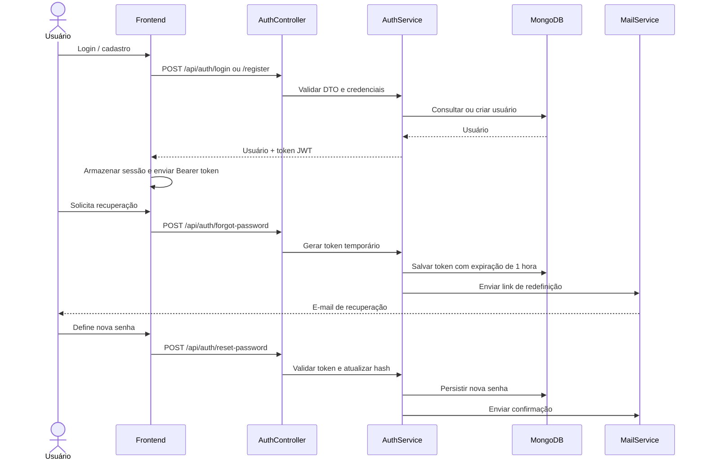
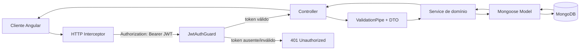
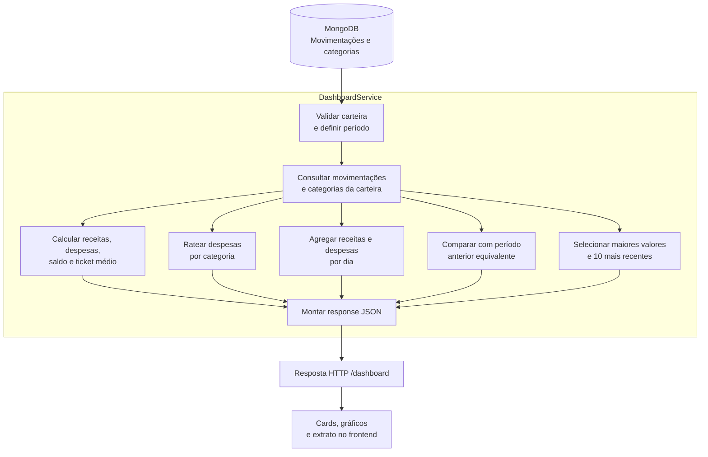
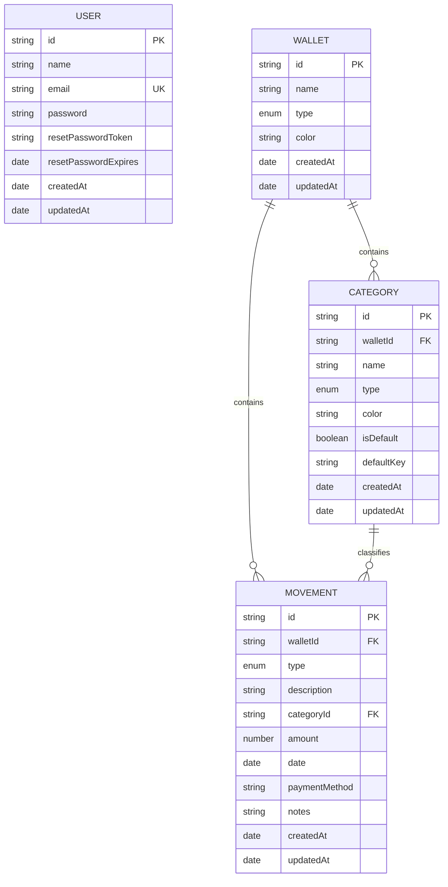

# Finan$e — Backend

> API REST responsável pela autenticação, persistência e processamento dos dados financeiros do sistema Finan$e.

[](https://nestjs.com/)
[](https://www.typescriptlang.org/)
[](https://www.mongodb.com/)

## Visão geral

O backend fornece uma API modular em NestJS para:

- autenticação com JWT e proteção de recursos;
- cadastro, login, perfil e alteração de senha;
- recuperação de senha com token temporário e envio de e-mail;
- gerenciamento de carteiras;
- categorias padrão e personalizadas;
- movimentações financeiras com paginação, filtros e ordenação;
- consolidação dos indicadores do dashboard;
- validação de entrada e persistência no MongoDB.

## Stack

| Tecnologia | Uso |
| --- | --- |
| NestJS 11 | Framework, módulos, controllers e injeção de dependência |
| TypeScript 5.9 | Tipagem e organização do domínio |
| MongoDB 8 + Mongoose 8 | Banco de dados e schemas |
| Passport + JWT | Autenticação e autorização de endpoints |
| bcryptjs | Hash e validação de senhas |
| class-validator / class-transformer | Validação e transformação de DTOs |
| Nodemailer | E-mails de recuperação e alteração de senha |
| Jest + Supertest | Testes unitários e e2e |

## Pré-requisitos

- Node.js 20 ou superior;
- npm 10 ou superior;
- Docker Desktop com Docker Compose;
- uma conta SMTP, caso os fluxos de e-mail sejam utilizados.

## Configuração

Copie o arquivo de exemplo e ajuste os valores:

```bash
cp .env.example .env
```

Principais variáveis:

| Variável | Exemplo | Finalidade |
| --- | --- | --- |
| `PORT` | `3000` | Porta da API |
| `MONGODB_URI` | `mongodb://localhost:27017/finance` | Conexão com MongoDB |
| `FRONTEND_ORIGIN` | `http://localhost:4200` | Origem autorizada pelo CORS |
| `JWT_SECRET` | valor privado | Chave de assinatura do JWT |
| `JWT_EXPIRES_IN` | `7d` | Validade esperada do token (atualmente definida em 7 dias no serviço) |
| `MAIL_HOST` | `smtp.gmail.com` | Servidor SMTP |
| `MAIL_PORT` | `587` | Porta SMTP |
| `MAIL_USER` / `MAIL_PASS` | credenciais SMTP | Remetente dos e-mails |

> Nunca versione o arquivo `.env`, credenciais SMTP ou uma chave JWT real. Para Gmail, use uma App Password em vez da senha principal.

## Instalação e execução

```bash
npm install
docker compose up -d
npm run start:dev
```

A API estará disponível em <http://localhost:3000/api>. O MongoDB ficará exposto em `localhost:27017` e os dados serão mantidos no volume Docker `finance_mongo_data`.

### Scripts disponíveis

| Comando | Descrição |
| --- | --- |
| `npm run start:dev` | Executa a API em modo desenvolvimento com watch |
| `npm run start` | Inicia a aplicação compilada pelo Nest |
| `npm run build` | Compila o projeto para `dist/` |
| `npm run start:prod` | Executa `dist/main.js` |
| `npm test` | Executa os testes unitários |
| `npm run test:watch` | Executa os testes em modo observação |
| `npm run test:e2e` | Executa os testes end-to-end configurados |

## Arquitetura modular

```text
src/
├── auth/          registro, login, JWT, recuperação e guards
├── users/         usuários e persistência do perfil
├── mail/          templates e envio de e-mails transacionais
├── wallets/       carteiras e seleção do contexto financeiro
├── categories/    categorias padrão e personalizadas
├── movements/     receitas, despesas, filtros e paginação
├── dashboard/     agregações e indicadores financeiros
├── common/
│   ├── enums/     tipos compartilhados
│   ├── interfaces/contratos de resposta
│   └── utils/     utilitários, incluindo datas
├── app.module.ts  composição dos módulos
└── main.ts        bootstrap, prefixo /api, CORS e ValidationPipe
```

## Fluxo de autenticação



## Fluxo de uma requisição protegida



## Fluxo de tratamento dos dados do dashboard

O endpoint `GET /api/wallets/:walletId/dashboard` é processado pelo `DashboardService` em etapas. A carteira é validada antes da consulta, os dados são filtrados pelo período informado e o backend devolve um contrato pronto para os cards, gráficos e extrato do frontend.



### Regras de tratamento

1. **Período e escopo:** valida a existência da carteira; sem datas, utiliza o primeiro e o último dia do mês corrente; `categoryId` aplica um filtro adicional.
2. **Resumo financeiro (`summary`):** separa receitas e despesas, soma os valores, calcula `balance = totalIncome - totalExpense` e calcula o ticket médio das despesas.
3. **Despesas por categoria (`categoryExpenses`):** agrega as despesas por categoria, calcula o percentual sobre o total, preserva nome/cor e remove categorias sem movimentação no período.
4. **Série temporal (`incomeExpenseByDate`):** agrupa entradas e saídas por data no formato `AAAA-MM-DD`.
5. **Comparativo (`comparison`):** cria uma janela anterior com a mesma duração, calcula saldo anterior, diferença nominal, percentual e o indicador `improved`.
6. **Destaques:** identifica a maior receita, a maior despesa e retorna as dez movimentações mais recentes ordenadas por data decrescente.

### Contrato de saída resumido

| Bloco | Conteúdo | Consumo no frontend |
| --- | --- | --- |
| `period` | Datas inicial e final consideradas | Seletor/cabeçalho do período |
| `summary` | Receitas, despesas, saldo, quantidade e ticket médio | Cards superiores |
| `highlights` | Maior receita e maior despesa | Cards de destaque |
| `comparison` | Saldo anterior, diferença, percentual e melhora | Banner de desempenho |
| `categoryExpenses` | Total e percentual por categoria | Gráfico de rosca |
| `incomeExpenseByDate` | Totais diários de entradas e saídas | Gráfico de linhas |
| `recentMovements` | Até dez lançamentos recentes | Extrato resumido |

### Exemplo de resposta do dashboard

```json
{
  "period": {
    "startDate": "2026-11-01",
    "endDate": "2026-11-30"
  },
  "summary": {
    "totalIncome": 5800,
    "totalExpense": 2350,
    "balance": 3450,
    "totalMovements": 24,
    "averageExpense": 146.88
  },
  "highlights": {
    "biggestIncome": {
      "id": "mov_01",
      "description": "Salário",
      "amount": 5000,
      "date": "2026-11-05",
      "categoryId": "cat_01",
      "type": "income"
    },
    "biggestExpense": {
      "id": "mov_02",
      "description": "Aluguel",
      "amount": 1200,
      "date": "2026-11-08",
      "categoryId": "cat_02",
      "type": "expense"
    }
  },
  "comparison": {
    "previousBalance": 2900,
    "difference": 550,
    "percentage": 19,
    "hasPreviousPeriodData": true,
    "improved": true
  },
  "categoryExpenses": [
    {
      "id": "cat_02",
      "name": "Moradia",
      "color": "#6366f1",
      "amount": 1200,
      "percentage": 51.1
    },
    {
      "id": "cat_03",
      "name": "Alimentação",
      "color": "#f59e0b",
      "amount": 650,
      "percentage": 27.7
    }
  ],
  "incomeExpenseByDate": [
    { "date": "2026-11-05", "income": 5000, "expense": 0 },
    { "date": "2026-11-08", "income": 0, "expense": 1200 },
    { "date": "2026-11-12", "income": 800, "expense": 150 }
  ],
  "recentMovements": [
    {
      "id": "mov_10",
      "type": "expense",
      "description": "Supermercado",
      "categoryId": "cat_03",
      "amount": 250,
      "date": "2026-11-25",
      "paymentMethod": "CREDIT_CARD",
      "notes": "Compras do mês"
    }
  ]
}
```

> Os valores `type` seguem os enums da API (`income` e `expense`). Categorias sem despesas no período não aparecem em `categoryExpenses`.

## Modelo de dados do banco

A persistência utiliza MongoDB com Mongoose. Cada documento possui um identificador público `id`; o `_id` interno do MongoDB é removido das respostas serializadas. Os schemas usam `timestamps: true` e `versionKey: false`.



> **Observação:** o diagrama representa as referências lógicas usadas pela aplicação. O MongoDB não cria foreign keys relacionais; `walletId` e `categoryId` são identificadores mantidos pela camada de serviços.

### Coleções e regras principais

| Coleção | Responsabilidade | Regras relevantes | Índices principais |
| --- | --- | --- | --- |
| `users` | Identidade e autenticação | E-mail único; senha em bcrypt; token de recuperação temporário | `id`, `email` |
| `wallets` | Contextos financeiros | Nome, tipo e cor obrigatórios; uma carteira é o escopo dos dados | `id` |
| `categories` | Classificação de receitas/despesas | Tipo e cor obrigatórios; categorias padrão são criadas com a carteira | `id`, `walletId`, `type`, `(walletId, type, name)` único |
| `movements` | Lançamentos financeiros | Tipo, descrição, categoria, valor positivo, data e forma de pagamento | `id`, `walletId`, `type`, `description`, `categoryId`, `date`, `(walletId, date)`, `(walletId, type, categoryId, date)` |

### Regras de integridade aplicadas pela aplicação

- Ao criar uma carteira, as categorias padrão são inseridas automaticamente para aquele `walletId`.
- Ao excluir uma carteira, suas categorias e movimentações são removidas em conjunto pelo `WalletsService`.
- Categorias possuem unicidade por carteira, tipo e nome, sem diferenciação de maiúsculas/minúsculas.
- Movimentações são sempre consultadas pelo `walletId`, evitando misturar dados entre carteiras.
- Valores monetários devem ser maiores que zero e cores seguem o formato hexadecimal `#RRGGBB`.
- Os campos sensíveis do usuário (`password`, token e expiração de recuperação) não são expostos no `toJSON`.

## Endpoints

Todos os endpoints possuem o prefixo `/api`.

### Autenticação

| Método | Rota | Proteção | Descrição |
| --- | --- | --- | --- |
| `POST` | `/auth/register` | pública | Cria usuário e retorna JWT |
| `POST` | `/auth/login` | pública | Valida credenciais e retorna JWT |
| `POST` | `/auth/forgot-password` | pública | Solicita recuperação por e-mail |
| `POST` | `/auth/reset-password` | pública | Redefine senha com token temporário |
| `GET` | `/auth/me` | JWT | Retorna o perfil autenticado |
| `POST` | `/auth/change-password` | JWT | Altera a senha atual |

### Carteiras

| Método | Rota | Descrição |
| --- | --- | --- |
| `GET` | `/wallets` | Lista carteiras |
| `POST` | `/wallets` | Cria carteira |
| `GET` | `/wallets/:walletId` | Consulta carteira |
| `PATCH` | `/wallets/:walletId` | Atualiza carteira |
| `DELETE` | `/wallets/:walletId` | Exclui carteira |

### Categorias

| Método | Rota | Descrição |
| --- | --- | --- |
| `GET` | `/wallets/:walletId/categories` | Lista categorias, com filtro opcional por tipo |
| `POST` | `/wallets/:walletId/categories` | Cria categoria personalizada |
| `DELETE` | `/wallets/:walletId/categories/:categoryId` | Exclui categoria |

### Movimentações

| Método | Rota | Descrição |
| --- | --- | --- |
| `GET` | `/wallets/:walletId/movements` | Lista com busca, filtros, paginação e ordenação |
| `GET` | `/wallets/:walletId/movements/:movementId` | Consulta uma movimentação |
| `POST` | `/wallets/:walletId/movements` | Cria receita ou despesa |
| `PATCH` | `/wallets/:walletId/movements/:movementId` | Atualiza movimentação |
| `DELETE` | `/wallets/:walletId/movements/:movementId` | Exclui movimentação |

### Dashboard

| Método | Rota | Descrição |
| --- | --- | --- |
| `GET` | `/wallets/:walletId/dashboard` | Consolida indicadores do período |

Parâmetros opcionais do dashboard: `startDate`, `endDate` e `categoryId`.

Parâmetros úteis do histórico: `search`, `type`, `categoryId`, `startDate`, `endDate`, `page`, `limit`, `sortBy` e `sortOrder`.

## Tratamento do dashboard

O `DashboardService`:

1. valida a carteira e define o mês corrente quando o período não é informado;
2. separa receitas e despesas e calcula totais, saldo e ticket médio;
3. calcula o rateio de despesas por categoria, removendo categorias zeradas;
4. agrupa receitas e despesas por dia;
5. compara o saldo com uma janela anterior de mesma duração;
6. identifica os maiores lançamentos e retorna as dez movimentações mais recentes.

O contrato completo e o exemplo de JSON estão documentados na seção [Exemplo de resposta do dashboard](#exemplo-de-resposta-do-dashboard) deste README.

## Segurança e confiabilidade

- Senhas são armazenadas com hash bcrypt.
- Rotas de perfil e alteração de senha exigem JWT.
- Tokens de recuperação são aleatórios, temporários e invalidados após o uso.
- `ValidationPipe` usa `whitelist` e `transform` para controlar entradas.
- CORS é limitado à origem configurada em `FRONTEND_ORIGIN`.
- Erros de recuperação não revelam se um e-mail existe, reduzindo enumeração de usuários.
- O domínio é separado por `walletId`, mantendo os dados organizados por carteira.

## Entregas acadêmicas

### AC1 — Cadastro de movimentações ✅

API REST, DTOs, validação, carteiras, categorias padrão, categorias personalizadas e persistência no MongoDB.

### AC2 — Histórico de movimentações ✅

Consulta paginada, busca, filtros por tipo/categoria/período, ordenação, atualização e exclusão.

### AC3 — Dashboard financeiro ✅

Resumo, saldo, ticket médio, destaques, comparativo histórico, rateio por categoria e série temporal diária.

### Evolução de autenticação ✅

Usuários, JWT, guards, perfil, alteração de senha, recuperação por e-mail e confirmação transacional.

## Documentação relacionada

- [Frontend Angular](https://github.com/MichelDeziderio/finance-frontend/blob/main/README.md)
